 

 

### 🌸 ₊˚⊹♡ About ~READ~Me ♡⊹˚₊ 🌸

  

Hiii, I’m **Harshita** — but you can call me **Harris**! 🎀

I’m a final-year **IT student**, and I’ve just finished my final exams and practicals. Three years of classes, projects, notes, deadlines, and coffee later, I’m standing at the beginning of a brand-new chapter. 🎓✨

I’m curious about all things tech and love discovering cool ideas, clever tools, and little pieces of technology that make me go, *“Wait, that’s so cool!”* I’m also a space-and-planets enthusiast, so you might catch me daydreaming about distant worlds between coding sessions. 🌙🪐

Lately, I’ve been especially curious about **game development**. I’m still at the beginning of the journey and learning from scratch, but I’ve started exploring **Godot** and its lovely little 2D game-making world. There may already be a tiny game idea taking shape in there… 🎮🌱

A big dream of mine is to study abroad and build a life beyond India. I keep a whole Notion page for that dream — filled with plans, universities, study goals, and the tech and coding skills I want to grow along the way. One small step at a time, I’m making that faraway dream feel a little closer. 🌍💌

I’m inspired by *Yoora Jung* and *Gazi* influencers — two very different people whose journeys remind me that there are many lovely ways to learn, grow, and find your own path. ✨

 
 

### 🎀 ₊˚⊹♡ A Little Snapshot of Me ♡⊹˚₊ 🎀

  

| | A little thing about me |
|---|---|
| 🎓 | Final-year IT student from Asia |
| 💻 | Curious about technology and always ready to explore |
| 🪐 | Happiest when learning about space and planets |
| 🎮 | Beginning my game-dev adventure with Godot |
| 📚 | Growing my coding skills, one step at a time |
| 🌍 | Dreaming, planning, and working toward studying abroad |
| 🎀 | Nickname: Harris — adventurous, curious, and still leveling up! |

 
 

### 🔭 ₊˚⊹♡ Things I’m Exploring ♡⊹˚₊ 🔭

  

*My skills are a work in progress, just like me — learning, growing, and collecting new things to try!* 🌼

 
 

### 🗺️ ₊˚⊹♡ My Little Roadmap ♡⊹˚₊ 🗺️
  

  

- [x] Finish my final IT course 🎓
- [x] Make a home for my big dreams 💌
- [x] Start exploring the world of game development 🎮
- [ ] Keep learning and building my coding skills 🌱
- [ ] Make a tiny game I’m proud to share ✨
- [ ] Take a step closer to my dream university 🌍

🍵 A tiny note for  future Me

I don’t have every step figured out yet — and that’s okay. I’m learning as I go, staying curious, and letting each little discovery point me toward the next one. Here’s to new beginnings, brave plans, and the lovely things I haven’t built yet. 💗

 
 

### 💌 ₊˚⊹♡ Say Hello ♡⊹˚₊ 💌

  

I’m always happy to meet fellow learners, tech explorers, space lovers, and people who enjoy making things just for the joy of it. Let’s learn something new and cheer each other on! <3

  

--------------------✨⋆˚｡⋆୨୧˚ ~ °୨୧⋆｡˚⋆✨--------------------

  

**Made with 💖 by [@Harshita](https://github.com/H-arshita-H)**

*If you like what I’m learning or building, a ⭐ would make my day! maybe a week! Hehe <3*

